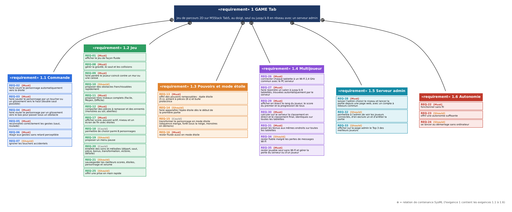
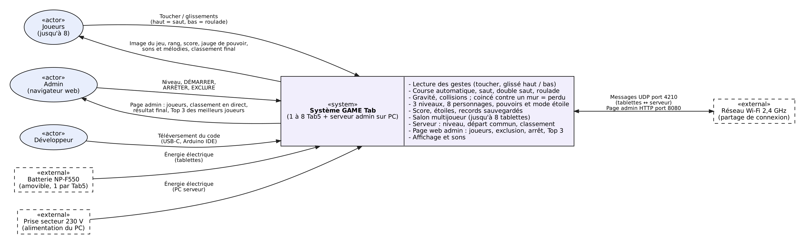
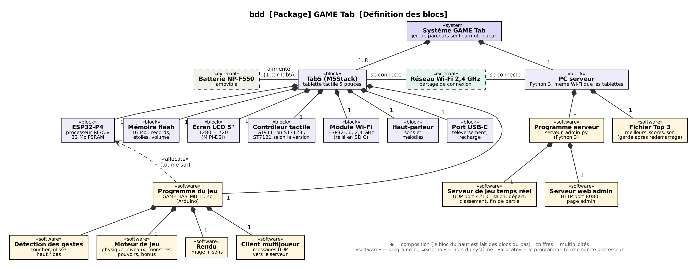
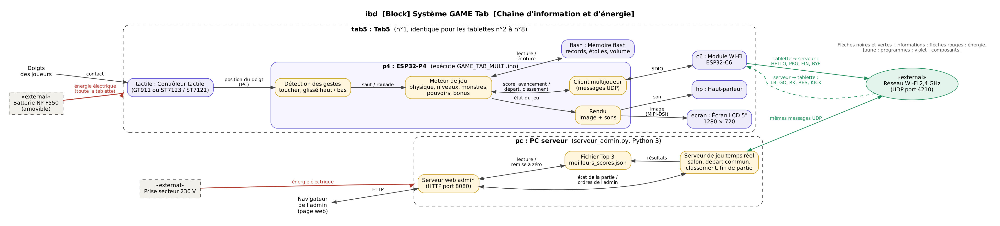
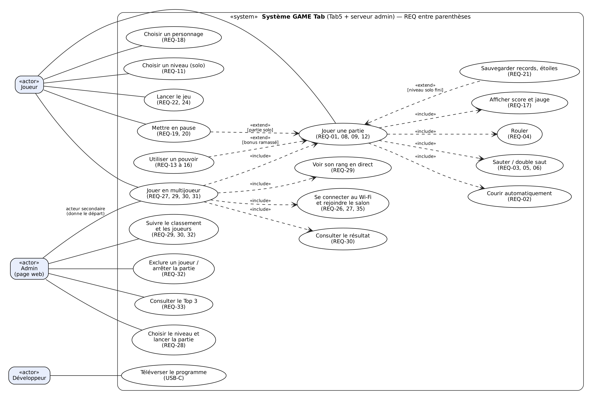
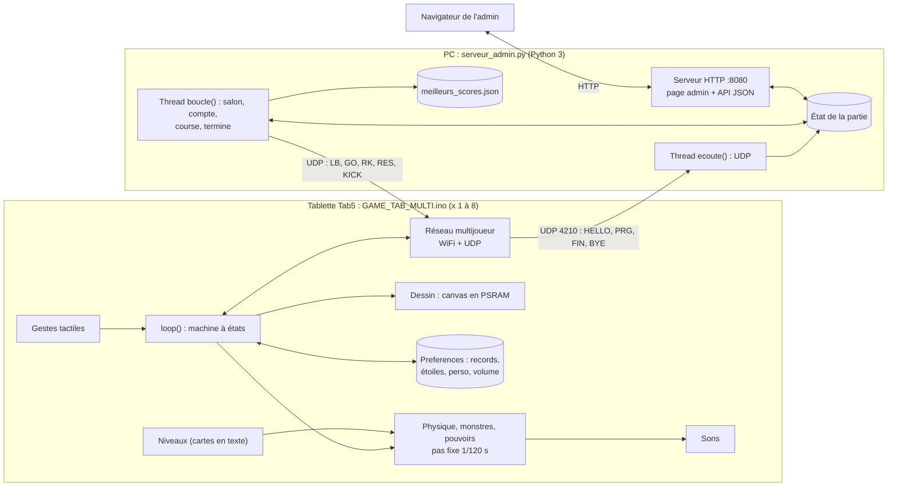

<p align="center">
  
</p>

# GAME TAB : jeu de parcours 2D sur M5Stack Tab5, en solo ou jusqu'à 8 joueurs

**GAME TAB** est un jeu de parcours 2D qui tourne entièrement sur une tablette **M5Stack Tab5**.
Le personnage court tout seul ; le joueur le commande au doigt pour sauter, faire un double saut ou une roulade.
En mode **multijoueur**, jusqu'à **8 tablettes** font la course en même temps, pilotées par un **serveur admin**
(un script Python sur un PC) et sa **page web**.

Projet pédagogique, filière SEE5, année 2026/2027, réalisé avec une démarche d'ingénierie système (MBSE / SysML).

> **Problématique** : comment faire un jeu de parcours 2D qui se commande au doigt sur une Tab5, qui reste fluide
> (au moins 30 images par seconde, mode étoile compris), qui tient sur batterie, et dont jusqu'à 8 tablettes partent
> ensemble, au même niveau, sous la conduite d'un serveur admin qui affiche le classement en direct ?

---

## Sommaire

- [Fonctionnalités](#fonctionnalités)
- [Contenu du dépôt](#contenu-du-dépôt)
- [Diagrammes d'architecture](#diagrammes-darchitecture)
- [Installation](#installation) (avec le [Lisez-moi du multijoueur](#lisez-moi--mode-multijoueur-en-3-étapes))
- [Utilisation](#utilisation)
- [Exigences](#exigences)
- [Cybersécurité](#cybersécurité)
- [Dépannage](#dépannage)

---

## Fonctionnalités

**Jeu (sur la tablette)**
- Course automatique vers la droite, physique avec gravité et collisions (pas de calcul fixe de 1/120 s).
- Commandes tactiles : **toucher** ou glisser vers le haut = saut, une 2e fois en l'air = **double saut**,
  glisser vers le bas = **roulade**. Le saut part environ 45 ms après que le doigt est posé.
- **3 niveaux** (Facile, Moyen, Difficile), **8 personnages**, pièces, monstres au sol et abeilles.
- **Pouvoirs** à ramasser : **épée étoile** (5 s de mode étoile avec transformation façon manga, forêt sous la neige,
  l'épée coupe caisses et monstres), **aimant** à pièces (8 s), **bulle** qui protège d'un monstre.
- Étoiles de fin (1 à 3), records, personnage et volume **gardés en mémoire** même tablette éteinte.
- Menu pause, sons et mélodies, compteur d'images par seconde.

**Multijoueur (tablettes + serveur admin)**
- Les tablettes se connectent au Wi-Fi 2,4 GHz et **trouvent le serveur toutes seules** (broadcast UDP).
- L'admin choisit le niveau et appuie sur **DÉMARRER** : compte à rebours 3-2-1 commun, puis la course.
- Bonus posés **aux mêmes endroits** sur toutes les tablettes (graine choisie par le serveur).
- **Classement en direct** sur chaque tablette et sur la page admin ; classement final calculé par le serveur
  (arrivé au drapeau, puis points, puis temps).
- L'admin peut **exclure** un joueur ou **arrêter** la partie. **Top 3** des meilleurs joueurs gardé après redémarrage.

---

## Contenu du dépôt

```
GAME-TAB/
├── README.md                          ce fichier
├── TROUBLESHOOTING.md                 guide de dépannage
├── firmware/
│   └── GAME_TAB_MULTI/
│       └── GAME_TAB_MULTI.ino         code source du jeu (C++ / Arduino, M5Stack Tab5)
├── serveur/
│   └── serveur_admin.py               code source du serveur admin multijoueur (Python 3)
└── docs/
    ├── GAME_TAB_SysML_v2.xlsx         dossier SysML complet (cahier des charges, diagrammes, tâches)
    ├── logo.png
    ├── securite/
    │   └── Rapport_Pentest_GAME_TAB.pdf   rapport de test d'intrusion (Red Team / Blue Team)
    └── architecture/
        ├── 01_exigences_req.png       diagramme d'exigences (req)
        ├── 02_contexte_bdd-ctx.png    diagramme de contexte (bdd-ctx)
        ├── 03_blocs_bdd.png           diagramme de définition de blocs (bdd)
        ├── 04_blocs_internes_ibd.png  diagramme de blocs internes (ibd)
        ├── 05_cas_utilisation_uc.png  diagramme de cas d'utilisation (uc)
        └── architecture_logicielle.md architecture logicielle, machine à états, séquence, protocole
```

---

## Diagrammes d'architecture

Les diagrammes SysML viennent du dossier [`docs/GAME_TAB_SysML_v2.xlsx`](docs/GAME_TAB_SysML_v2.xlsx).
Cliquer sur une image pour l'ouvrir en grand.

### Diagramme d'exigences (req) : 35 exigences
[](docs/architecture/01_exigences_req.png)

### Diagramme de contexte (bdd-ctx) : tablettes, serveur admin et page web
[](docs/architecture/02_contexte_bdd-ctx.png)

### Diagramme de définition de blocs (bdd)
[](docs/architecture/03_blocs_bdd.png)

### Diagramme de blocs internes (ibd) : jusqu'à 8 Tab5 reliées par Wi-Fi au PC serveur
[](docs/architecture/04_blocs_internes_ibd.png)

### Diagramme de cas d'utilisation (uc) : joueur et admin
[](docs/architecture/05_cas_utilisation_uc.png)

### Architecture logicielle

Vue d'ensemble des deux programmes et de leurs échanges. La version détaillée, avec la **machine à états** de la
tablette, le **diagramme de séquence** d'une partie multijoueur et le **protocole UDP**, est dans
[`docs/architecture/architecture_logicielle.md`](docs/architecture/architecture_logicielle.md).



---

## Installation

### Lisez-moi : mode multijoueur en 3 étapes

**1. Sur un PC** ([Python 3](https://www.python.org/downloads/) installé) relié au **même Wi-Fi** que les tablettes (2,4 GHz) :

```bash
python3 serveur_admin.py
```

(Windows : `py serveur_admin.py`)

- Le programme affiche l'adresse de la page admin, par exemple `http://192.168.1.20:8080`.
- Option : `--mdp MOTDEPASSE` pour protéger les boutons (adresse `...:8080/?mdp=MOTDEPASSE`).
- Si les tablettes ne trouvent pas le serveur : autoriser Python dans le pare-feu du PC
  (réseaux privés, UDP entrant, port 4210).

**2. Sur chaque tablette** : téléverser `GAME_TAB_MULTI.ino`, puis **ACCUEIL > MULTIJOUEUR**.
La tablette se connecte au Wi-Fi, trouve le serveur toute seule et attend dans le salon.

**3. Sur la page admin** : choisir le niveau, appuyer sur **DÉMARRER**.
- Compte à rebours 3-2-1 sur toutes les tablettes, puis la course.
- Pendant la course : classement en direct. **ARRÊTER LA PARTIE** termine tout de suite.
- **EXCLURE** retire un joueur. À la fin, chaque tablette affiche le classement.
- Pour une nouvelle manche : les joueurs appuient sur **REJOUER** (retour au salon).

Jusqu'à 8 joueurs. Le Wi-Fi et le mot de passe se règlent en haut du `.ino`.

**Top 3 des meilleurs joueurs** : la page admin affiche un podium. Chaque fin de partie le met à jour
(meilleur score de chaque joueur, à égalité le plus rapide). Il est gardé dans `meilleurs_scores.json`,
à côté de `serveur_admin.py`, donc il reste après un redémarrage. Bouton **« Remettre à zéro »** pour l'effacer.

Les étapes détaillées sont ci-dessous.

### Matériel

- 1 à 8 tablettes **M5Stack Tab5** (batterie NP-F550 pour jouer sans câble).
- Pour le multijoueur : un **PC** avec [Python 3](https://www.python.org/downloads/) et un réseau **Wi-Fi 2,4 GHz** commun
  (box ou partage de connexion d'un téléphone).

### 1. Le jeu sur la tablette

1. Installer **Arduino IDE** (version 2), puis le paquet de cartes **M5Stack** (ou **esp32** d'Espressif, version 3.x
   qui gère l'ESP32-P4 de la Tab5), et la bibliothèque **M5Unified** (*Outils > Gérer les bibliothèques*).
2. Ouvrir [`firmware/GAME_TAB_MULTI/GAME_TAB_MULTI.ino`](firmware/GAME_TAB_MULTI/GAME_TAB_MULTI.ino).
3. Pour le multijoueur, écrire le nom et le mot de passe de votre Wi-Fi en haut du fichier :
   ```cpp
   const char* WIFI_SSID = "NOM_DU_WIFI";
   const char* WIFI_MDP  = "MOT_DE_PASSE_WIFI";
   ```
4. Choisir la carte **M5Tab5**, activer la **PSRAM**, choisir le port, puis **Téléverser**.
   Recommencer sur chaque tablette avec **le même** fichier.

### 2. Le serveur admin sur le PC (multijoueur)

Aucune bibliothèque à installer : seulement **Python 3**. Le PC doit être sur **le même Wi-Fi** que les tablettes.

> **Python 3 n'est pas installé ?** Le télécharger ici : **[python.org/downloads](https://www.python.org/downloads/)**.
> Sous Windows, cocher **« Add python.exe to PATH »** au début de l'installation.
> Pour vérifier : ouvrir un terminal et taper `py --version` (Windows) ou `python3 --version` (Linux / macOS).

```bash
cd serveur
py serveur_admin.py
```

(sous Linux / macOS : `python3 serveur_admin.py`)

Le programme affiche l'adresse de la page admin, par exemple `http://192.168.1.20:8080`.

Options :

| Option | Défaut | Rôle |
|---|---|---|
| `--http PORT` | `8080` | Port de la page admin |
| `--udp PORT` | `4210` | Port des tablettes (doit être égal à `PORT_JEU` dans le `.ino`) |
| `--mdp MOTDEPASSE` | aucun | Protège les boutons ; ouvrir alors `http://ADRESSE:8080/?mdp=MOTDEPASSE` |

Si les tablettes ne trouvent pas le serveur : autoriser Python dans le **pare-feu** (réseaux privés, UDP entrant,
port 4210). Voir le [guide de dépannage](TROUBLESHOOTING.md#5-la-tablette-ne-trouve-pas-le-serveur).

---

## Utilisation

### En solo

**ACCUEIL → START → choix du niveau → partie.** Le bouton **PERSO** permet de choisir parmi 8 personnages.

| Geste | Action |
|---|---|
| Toucher l'écran, ou glisser vers le haut | Saut |
| La même chose une 2e fois, en l'air | Double saut |
| Glisser vers le bas | Roulade (passer sous les abeilles) |

Toucher un monstre, ou rester coincé contre un mur jusqu'à sortir de l'écran par la gauche = **perdu**.
Étoiles : 1 = niveau fini, 2 = la moitié des pièces, 3 = 80 % des pièces.

### En multijoueur

1. Lancer `serveur_admin.py` sur le PC et ouvrir la page admin.
2. Sur chaque tablette : **ACCUEIL > MULTIJOUEUR**. La tablette se connecte au Wi-Fi, trouve le serveur et attend
   dans le **salon**.
3. Sur la page admin : choisir le niveau, appuyer sur **DÉMARRER**. Compte à rebours 3-2-1 sur toutes les tablettes.
4. Pendant la course : classement en direct. **ARRÊTER LA PARTIE** termine tout de suite, **Exclure** retire un joueur.
5. À la fin, chaque tablette affiche le classement final. Pour une nouvelle manche : **REJOUER** (retour au salon).

---

## Exigences

Le cahier des charges complet (35 exigences, critères, priorités MoSCoW, méthodes de vérification) est dans
la feuille **CdC** de [`docs/GAME_TAB_SysML_v2.xlsx`](docs/GAME_TAB_SysML_v2.xlsx). Principales exigences :

| ID | Exigence | Critère |
|---|---|---|
| REQ-01 | Afficher le jeu de façon fluide | ≥ 30 images/s |
| REQ-03 | Sauter par un toucher ou un glissement vers le haut (double saut) | 10 sauts sur 10 |
| REQ-06 | Réagir aux gestes sans retard perceptible | Latence < 100 ms |
| REQ-11 | Proposer trois niveaux complets | Facile, Moyen, Difficile |
| REQ-13 | Offrir des pouvoirs : épée étoile, aimant, bulle | Visible, actif, jauge affichée |
| REQ-16 | Rester fluide en mode étoile | ≥ 30 images/s |
| REQ-21 | Sauvegarder scores, étoiles, personnage, volume | Conservés après extinction |
| REQ-22 | Fonctionner sans fil | Sur batterie NP-F550 |
| REQ-26 | Connecter chaque tablette au Wi-Fi 2,4 GHz commun | < 20 s, bouton RÉESSAYER |
| REQ-27 | Salon jusqu'à 8 tablettes, trouvées automatiquement | Sans saisir d'adresse |
| REQ-28 | Lancer la partie depuis une page web, départ commun | 3-2-1 simultané |
| REQ-30 | Classement en direct et final calculés par le serveur | Identiques sur toutes les tablettes |
| REQ-31 | Bonus aux mêmes endroits partout | Graine choisie par le serveur |
| REQ-34 | Rester fiable malgré les pertes Wi-Fi | Messages importants répétés |
| REQ-35 | Rester jouable seul sans Wi-Fi, gérer la perte d'un joueur | Joueur muet > 8 s : parti |

---

## Cybersécurité

Le mode multijoueur a fait l'objet d'un **test d'intrusion** (évaluation Red Team / Blue Team, en laboratoire isolé) :
**[Rapport de test d'intrusion (PDF)](docs/securite/Rapport_Pentest_GAME_TAB.pdf)**.

Périmètre : Wi-Fi 2,4 GHz partagé, protocole UDP 4210 du jeu, serveur admin Python (HTTP 8080) et tablettes Tab5.
Le jeu en solo n'est pas concerné : il ne communique avec rien. Niveau de risque global : **élevé**
(2 vulnérabilités critiques, 4 élevées, 3 moyennes).

| ID | Vulnérabilité | Sévérité | Remédiation principale | Priorité |
|---|---|---|---|---|
| VULN-01 | Surface d'attaque exposée (reconnaissance) | Moyenne | Réseau de jeu séparé, mot de passe aussi sur `GET /api/state` | P3 |
| VULN-02 | Wi-Fi faible / accès réseau non maîtrisé | Élevée | Mot de passe long et aléatoire, hors du code ; isolation des clients | P2 |
| VULN-03 | Protocole UDP sans authentification | **Critique** | Secret partagé + signature HMAC horodatée de chaque message | P1 |
| VULN-04 | Trafic UDP en clair (interception) | Élevée | Chiffrer et authentifier les messages (DTLS ou chiffrement + HMAC) | P2 |
| VULN-05 | Usurpation de joueur et injection de résultat | **Critique** | Lier chaque id à sa clé / son adresse ; contrôle de plausibilité des scores | P1 |
| VULN-06 | Faux serveur / détournement du salon | Élevée | Authentifier le serveur auprès des tablettes (clé pré-partagée) | P2 |
| VULN-07 | Déni de service (flood UDP, salon saturé) | Moyenne | Limiter le débit par source, bannissement temporaire | P3 |
| VULN-08 | Injection dans la page admin (XSS via id joueur) | Moyenne | `textContent` au lieu de `innerHTML`, id limité à `[A-Fa-f0-9]` | P3 |
| VULN-09 | Admin non protégé et absence de journalisation | Élevée | Mot de passe obligatoire dans l'en-tête, journal horodaté des actions | P2 |

En attendant ces corrections, pour une partie : utiliser un réseau Wi-Fi réservé au jeu avec un mot de passe fort,
lancer le serveur avec `--mdp`, et n'ouvrir la page admin que sur le PC de l'organisateur.

---

## Dépannage

Voir le guide complet : **[TROUBLESHOOTING.md](TROUBLESHOOTING.md)** (compilation, affichage, gestes, Wi-Fi,
pare-feu, serveur, partie multijoueur).
