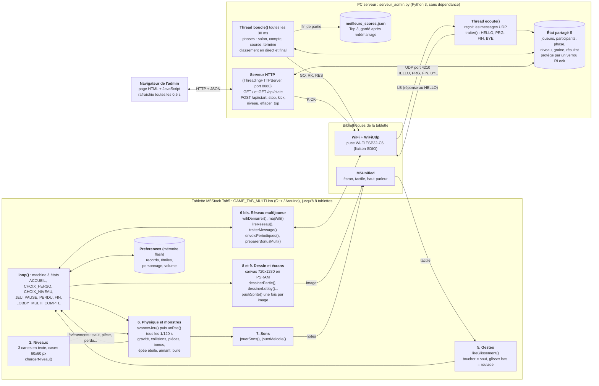
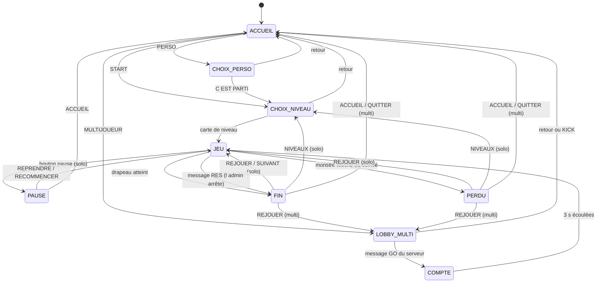
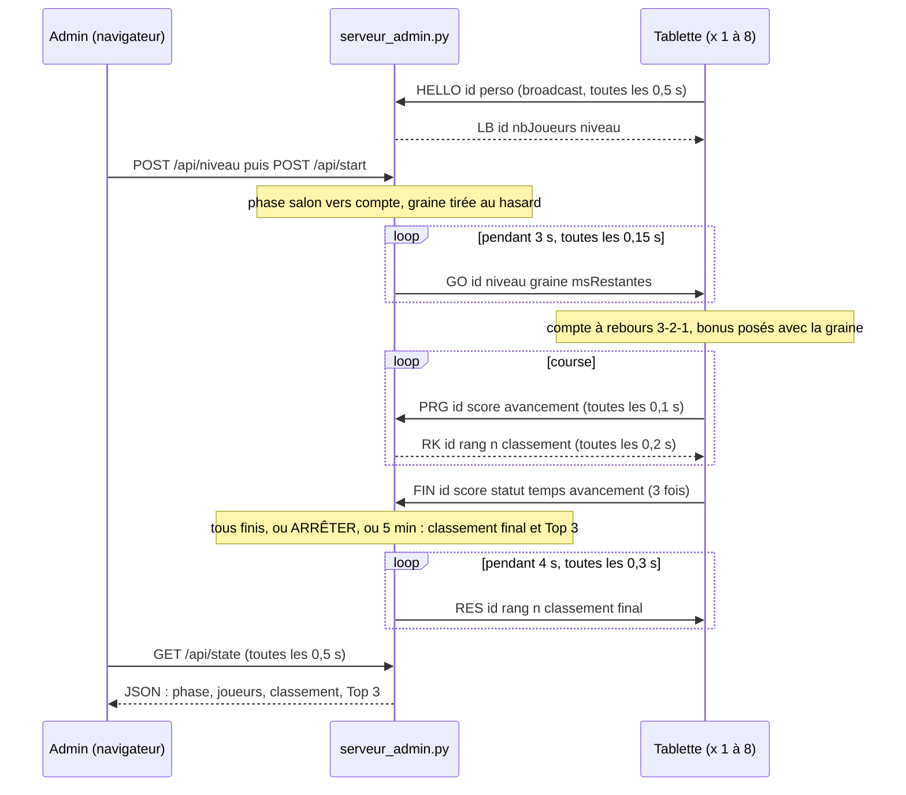

# Architecture logicielle de GAME TAB

Ce document complète les diagrammes SysML du dossier (exigences, contexte, blocs, cas d'utilisation)
avec la vue **logicielle** du projet : les deux programmes, leurs modules, et la façon dont ils communiquent.

- **`firmware/GAME_TAB_MULTI/GAME_TAB_MULTI.ino`** : le jeu, en C++ (Arduino), sur chaque M5Stack Tab5.
- **`serveur/serveur_admin.py`** : le serveur du mode multijoueur, en Python 3 (bibliothèque standard uniquement), sur un PC.

Les diagrammes ci-dessous sont écrits en [Mermaid](https://mermaid.js.org/) : GitHub les affiche directement.

---

## 1. Diagramme d'architecture logicielle (composants)

**Points clés de l'architecture :**

| Choix | Pourquoi |
|---|---|
| Le jeu tourne **entièrement sur chaque tablette** | Le nombre d'images par seconde ne dépend pas du réseau (REQ-01, REQ-16). |
| Les tablettes ne se parlent **pas entre elles** : elles parlent toutes au serveur | Un seul arbitre décide du départ, de la fin et du classement (REQ-28, REQ-30). |
| Messages **UDP courts** en texte `TYPE\|id\|...` | Simples à lire et à déboguer ; les messages importants sont répétés car le Wi-Fi peut en perdre (REQ-34). |
| **Graine commune** choisie par le serveur | Les bonus sont posés aux mêmes endroits sur toutes les tablettes : course équitable (REQ-31). |
| Découverte par **broadcast** | La tablette n'a pas besoin de connaître l'adresse du PC : elle l'apprend à la première réponse (REQ-27). |
| Physique à **pas fixe** (1/120 s) | Le personnage va à la même vitesse quel que soit le nombre d'images par seconde. |
| Dessin dans un **canvas** puis envoi d'un coup | Pas de scintillement à l'écran. |
| Serveur en **Python standard** | Rien à installer sur le PC à part Python 3. |

---

## 2. Machine à états de la tablette (stm)

---

## 3. Déroulement d'une partie multijoueur (séquence)

## 4. Protocole UDP (port 4210)

| Sens | Message | Rôle |
|---|---|---|
| tablette → serveur | `HELLO\|id\|perso` | « Je suis dans le salon » (toutes les 0,5 s) |
| tablette → serveur | `PRG\|id\|score\|pct` | Avancement pendant la course (10 fois par seconde) |
| tablette → serveur | `FIN\|id\|score\|statut\|temps\|pct` | Fin de course (statut 1 = drapeau, 0 = éliminé) |
| tablette → serveur | `BYE\|id` | Je quitte le multijoueur |
| serveur → tablette | `LB\|id\|joueurs\|niveau` | État du salon |
| serveur → tablette | `GO\|id\|niveau\|graine\|ms` | Départ : niveau, graine des bonus, ms avant le départ |
| serveur → tablette | `RK\|id\|rang\|n\|(nom\|score\|pct)*` | Classement en direct |
| serveur → tablette | `RES\|id\|rang\|n\|(nom\|score\|statut\|temps)*` | Classement final |
| serveur → tablette | `KICK\|id` | L'admin a exclu la tablette |

`id` = les 4 derniers caractères de l'adresse MAC de la tablette.
